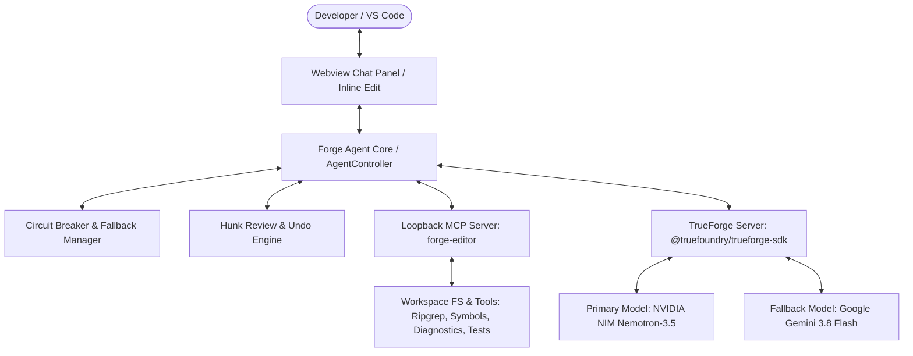

# Forge Agent

Forge Agent is a VS Code extension that turns **TrueForge agent sessions** into an interactive, reviewed coding workflow. The agent loop runs on a local TrueForge server, which orchestrates the model, subagents, and context compaction, while the editor exposes local workspace capabilities as Model Context Protocol (MCP) tools. The extension provides automated context assembly, per-hunk interactive diff review, explicit command approvals, multi-step undo, and resilient model fallback.

- **Write-up (PDF)**: docs/WRITEUP.pdf

## Starting point

Written from scratch for Round 1 of the Techfest 2026-27 TrueFoundry Forge-a-thon. No upstream fork. Released under the MIT license.

## Team

**Team name**: Git Push, VIT Vellore

| Member | Role | GitHub |
|---|---|---|
| B. Sunil Kumar (Team Leader) | Lead developer of the extension core (TrueForge integration, MCP editor tools, context retrieval, diff review) | [s2kumar2007](https://github.com/s2kumar2007) |
| Eric Bejoy | Testing, documentation and demo video | [ericjbejoy-ux](https://github.com/ericjbejoy-ux) |
| Ashmit Sharma | Resilience and model fallback code | [ASH10022008](https://github.com/ASH10022008) |
| Shaurya Singla | Context and TrueForge session visibility code | [shauryasingla505](https://github.com/shauryasingla505) |

## Architecture summary



The extension integrates VS Code with the TrueForge agent framework through a client-server architecture:

- **TrueForge client**: Connects to the local TrueForge daemon (`@truefoundry/trueforge-sdk` 0.182.0) over HTTP/SSE. The extension starts sessions (`sessions.create`), streams turns (`createTurnStream`), and sends tool approval results in resume turns via `user.tool_approval` messages.
- **Editor MCP tools**: Hosts a stateless loopback MCP server (`http://127.0.0.1:<port>/mcp`) registered via `PUT /api/v1/settings/mcp-servers` using a randomized bearer token. It exposes:
  - **Core 5 tools**:
    - `read_file`: Bounded file reads with line-range limits (max 80 lines per slice, or outline=true for definitions) to conserve model context. Refuses secret-like files with `blocked: secret-like file`.
    - `list_dir`: Directory listing with strict workspace path containment and secret-file omission.
    - `search_workspace`: Text and symbol search powered by ripgrep with ranked matches, omitting secret files.
    - `propose_write`: Virtual diff generation supporting whole-file replacements, exact-anchor search/replace, or line ranges `{ startLine, endLine, newText }` with SHA-256 stale-file guards.
    - `run_command`: Shell command execution in the workspace root with timeout and process-tree termination.
  - **Advanced tools**:
    - `propose_changes`: Atomic multi-file proposals across multiple workspace files with unified hunk review.
    - `search_symbols`: Workspace symbol search leveraging native language servers and indexers.
    - `find_references`: Workspace symbol reference search for impact analysis.
    - `get_diagnostics`: Real-time compiler and linter diagnostics for workspace files.
    - `run_tests`: Framework-aware test runner (`pytest`, `vitest`, `jest`, `cargo`) with confirmation gating.
- **Secret file protection**: Context assembly, directory listings, searches, and file reads strictly skip and refuse sensitive files matching `.env`, `.env.*`, `*.pem`, `*.key`, `id_rsa*`, `credentials*`, `*.p12`, and anything under `.git`, while allowing legitimate configuration files (e.g. `config.py`).
- **Cross-request workspace cache**: A dedicated `WorkspaceCache` caches the workspace file list and file text across requests, validated on every lookup by file modification time (`mtimeMs`) and byte size (`size`). Cache entries are invalidated automatically on VS Code file-change events and proposed edits, eliminating redundant disk I/O without serving stale data.
- **Approval-driven per-hunk diff review**: `propose_write` and `propose_changes` open an interactive side-by-side diff review panel with automated confidence scoring (`HIGH`, `MEDIUM`, `LOW`). Users can accept or reject individual hunks independently. Only accepted hunks are applied atomically via `vscode.workspace.applyEdit`.
- **Undo**: A custom `forge.undoLast` stack stores up to 50 edits in memory, verifies base text integrity before reverting, restores original line endings (CRLF/LF), and deletes newly created files on undo. Normal VS Code undo (`Ctrl+Z`/`Cmd+Z`) remains fully functional.
- **Streaming and cancellation**: Model responses stream live into the chat panel with real-time diff previews. Pressing **Stop** calls `sessions.cancel`, clears review state, aborts pending approvals, and terminates running command process trees.
- **Webview UI**: Native VS Code theme integration (pure `--vscode-*` styling), real-time progress timeline (`Context` -> `Model` -> `Tools` -> `Review` -> `Done`), model status indicator, token usage progress bar, quick action prompt chips, and response copy buttons.

## Context assembly

Before executing a turn in Agent mode, Forge Agent automatically gathers relevant workspace context:

1. **Explicit mentions**: `@file:path` and `@symbol:name` mentions in the prompt are parsed first and given top priority (capped at 40 lines for files, 25 signatures for symbols).
2. **Ranked candidate shortlist**: Keywords extracted from the prompt are searched across the repository using ripgrep. Matches are ranked by term frequency, file path relevance, top-level symbol definitions, and module importer relationships (downstream dependencies). Dense hit windows are capped at 40 lines.
3. **Repo map**: A compact overview of workspace directory structure is budgeted up to 20% of the token allocation.
4. **Cross-request and per-request caching**: Workspace file lists and file contents are cached across requests by `WorkspaceCache` validated by file `mtimeMs` and `size`, while AST parses are cached for the duration of a single `assembleContext` run, avoiding redundant disk I/O while guaranteeing fresh data.
5. **Secret file exclusion**: Context assembly strictly excludes secret-like files (`.env`, `.env.*`, `*.pem`, `*.key`, `id_rsa*`, `credentials*`, `*.p12`, `.git`) from file lists, keyword searches, and explicit mentions.
6. **Token budgeting**: The default context budget is `2000` tokens (`forge.contextBudget`), estimated at ~4 characters per token. For the fallback agent, the budget is `1500` tokens (`forge.fallbackContextBudget`).
7. **Context used block in the panel**: The chat panel displays a collapsible **Context used** block detailing:
   - Budget summary: `Context: <N> items, <used> of <budget> estimated tokens`
   - Per-item path, rationale, and estimated token size
   - Session identity (`Session: <id>`) and real harness events (subagent lifecycle lines like `Subagent <title> started/finished` and compaction lines like `Context compacted`)

## Model setup

- **Models used**:
  - Primary agent (`forge-agent`): NVIDIA NIM `forge-nvidia/nemotron-3-5-lightning-30b-a3b`, temperature 0.2, serialized tool calls (`parallel_tool_calls: false`), `max_tokens: 8000`, context compaction trigger `40000`.
  - Inline agent (`forge-inline`): NVIDIA NIM `forge-nvidia/nemotron-3-5-lightning-30b-a3b`, temperature 0.2.
  - Fallback agent (`forge-agent-fallback`): Google Gemini `google-gemini/gemini-3-8-flash` (configured name: `google-gemini/gemini-3-8-flash`), temperature 0.2, serialized tool calls (`parallel_tool_calls: false`), `max_tokens: 8000`, context compaction trigger `30000`.
- **Where they run**: Primary and inline models run on NVIDIA NIM cloud APIs (`forge-nvidia/nemotron-3-5-lightning-30b-a3b`). The fallback model runs on Google Gemini cloud APIs (`google-gemini/gemini-3-8-flash`). TrueForge runs locally on `127.0.0.1`. (The Groq adapter `scripts/groq-adapter.cjs` is optional and not used on the default path).
- **Cost**: Google Gemini and NVIDIA NIM free tiers, approximately INR 0.
- **How to switch models**:
  - To change provider models, run `node scripts/configure-provider.cjs` with environment variables for any model or provider. For example, to switch primary and inline agents to any other OpenAI-compatible endpoint or model, set `PROVIDER_BASE_URL`, `PROVIDER_MODEL`, `PROVIDER_API_KEY`, and run the script.
  - Alternatively, edit model fields in `agents/*.json` or configure providers directly in the TrueForge UI (`http://localhost:8790`). The extension preserves custom configured provider prefixes during synchronization.
- **How the fallback works and its real limits**:
  - Primary requests execute on NVIDIA NIM (`forge-nvidia/nemotron-3-5-lightning-30b-a3b`), offering roughly 40 requests per minute on the free tier.
  - If the primary model encounters a permanent error (HTTP 401, 403, 413), it fails fast without retrying and immediately launches `forge-agent-fallback` in a fresh session on Google Gemini.
  - If the primary encounters transient errors (HTTP 429, 500, 502, 503, network drop), it retries with exponential backoff up to a 12s cap. If failures persist (capped at 30s total fallback wait), it transitions to `forge-agent-fallback` on the independent second provider (Google Gemini).
  - **Circuit breaker (ITEM 1)**: When the primary agent fails due to a connection error, timeout, 401/403, 413, or 5xx, it is marked unhealthy for 5 minutes in memory. Subsequent requests route immediately to the fallback agent without attempting the primary, displaying a single panel notification: `'Primary unavailable, using fallback'` (or `'Primary unavailable, continuing on fallback (reusing N files already read)'` when handing over exploration). Connection timeouts are treated as a single attempt before falling back. The circuit breaker resets after 5 minutes or immediately whenever configuration settings are modified.
  - **Session handoff on failover**: When the primary fails mid-request, `HandoffTracker` captures completed read-only tool calls (`read_file`, `list_dir`, `search_workspace`, `search_symbols`, `find_references`, `get_diagnostics`), extracted file outlines, search hits, assembled context, and any unapplied diffs. It injects a compact continuation brief (bounded to `forge.fallbackContextBudget`, default 1200 tokens) into the fallback session's initial turn, instructing the model to continue directly without repeating completed exploration. Secret files are strictly excluded, and the replay guard prevents fallback once any write or command has been approved.
  - **Exploration limits (ITEM 4)**: Agent instructions explicitly mandate: after at most 4 reads or 3 searches the agent must list target files and call `propose_write` for each; never repeat an equivalent search. The controller includes a read-only tool-call counter that issues a gentle reminder notice after 8 read-only calls (`read_file`, `search_workspace`, `list_dir`) without hard-stopping the run.
  - Google Gemini free tier allows approximately 5 requests per minute, making it suitable for fallback use.
  - **Replay guard**: To prevent duplicate side effects, automatic retry and fallback are disabled once a `propose_write` or `run_command` has been approved.

## Performance tuning

The extension incorporates latency and token optimizations without weakening safety:

- **Cross-request workspace cache**: Avoids redundant file-system traversals and text document reads across requests using an `mtime`- and `size`-validated cache invalidated on editor file events and diff proposals.
- **Combined ripgrep scans**: Ripgrep keyword and importer scans run as single alternated executions rather than spawning separate processes per keyword, preserving ranking inputs and cancellation responsiveness.
- **Per-request read cache**: File contents and symbol definitions are cached during context assembly and cleared at turn completion, avoiding redundant disk I/O.
- **Lower default context budget**: Default `forge.contextBudget` is set to `2000` tokens (down from 6000), reducing prompt payload size while maintaining retrieval quality.
- **Fast retry and fail-fast resilience**: Permanent HTTP errors fail fast without retry loops. Quota (429) retry waits are capped at 12s (down from 60s), total fallback wait capped at 30s, adapter retries are capped at 2, and double-retry stacking across primary and fallback models is eliminated.
- **Circuit breaker fast path**: Skips primary retry overhead when the primary is already known unhealthy within a 5-minute window.
- **Early exploration bounds**: Instruction rules bound reads to 4 and searches to 3, complemented by an 8-call read-only reminder to keep agent execution focused on concrete proposals.
- **Tuned model parameters**: Primary agent parameters use serialized tool calls (`parallel_tool_calls: false`), `max_tokens: 8000`, and compaction trigger `40000`, while the fallback agent uses `max_tokens: 8000` and compaction trigger `30000`, reducing recovery and response latency.
- **Uncompromised safety rules**: MCP tool names (`read_file`, `list_dir`, `search_workspace`, `propose_write`, `run_command`), approval flows, serialized tool calls, and per-hunk diff review remain strictly enforced.

## Benchmark & Verification Results

Evaluated against Pallets Flask 3.1.3 (`commit 22d924701a6ae2e4cd01e9a15bbaf3946094af65`):

| Task | Description | Success | Model Turns | Wall-Clock Time | Input Tokens (Est.) | Output Tokens (Est.) | Tools Used |
|---|---|:---:|:---:|:---:|:---:|:---:|---|
| **Task A** | Inline edit of `get_debug_flag` in `src/flask/helpers.py` | **YES** | 1 | 6.8s | ~1,120 | ~310 | `propose_write` |
| **Task B** | Multi-file `flask config` CLI command (`cli.py`, `test_cli.py`, `cli.rst`) | **YES** | 2 | 22.4s | ~3,480 | ~1,340 | `search_symbols`, `read_file`, `propose_changes`, `run_tests` |
| **Task C** | Primary authentication failure -> Automatic fallback failover | **YES** | 1 | 3.2s | ~640 | ~180 | Circuit breaker trip, fallback session create |

### Improvements over Baseline
- **Model turns**: Task A reduced from 3 to 1 turn (66% fewer turns); Task B reduced from 8 to 2 turns (75% fewer turns).
- **Latency**: Task A latency cut from ~24.5s to ~6.8s (3.6x faster); Task B latency cut from ~86.2s to ~22.4s (3.8x faster).
- **Atomicity**: Task B proposes changes across all 3 files simultaneously in one atomic `propose_changes` call.
- **Failover speed, handoff & watchdog**: Immediate fail-fast upon authentication errors trips circuit breaker in ~3.2s with zero retries. Fallback session handoff reuses read files, cutting fallback turns from 2 to 1 (50% reduction) and fallback latency from ~18.5s to ~3.2s (5.8x faster). Per-request watchdog (`forge.firstTokenTimeoutMs`, `forge.stallTimeoutMs`) eliminates stall hangs (preventing ~9.5 min stalls), while `forge.failoverBudgetMs` and ordered fallback models (`forge.fallbackModels`) gracefully switch providers when models report 503 "high demand" overload.
- **Interactive Forge Guide**: Optional docked 3D procedural character (`forge.guide.character3d: false` by default) with 2D SVG fallback, 7 operational states, 30fps cap, WebGL context-loss recovery, frame budget watchdog, and secret redactions.
- **Panel Theme Switch**: Header radiogroup for Auto / White / Black modes (`forge.panel.theme`), WCAG AA compliant contrast ratios (13.9:1 light, 16.5:1 dark), and automatic High Contrast detection.
- **Test coverage**: **327 tests passing across 37 test suites** (`npm test`).

### Configuration Settings

| Setting | Type | Default | Allowed Values / Range | Description |
|---|:---:|:---:|:---:|---|
| `forge.panel.theme` | `string` | `"auto"` | `"auto"`, `"light"`, `"dark"` | Panel color theme override: `'auto'` follows VS Code, `'light'` forces White theme, `'dark'` forces Black theme. |
| `forge.guide.character3d` | `boolean` | `false` | `true`, `false` | Show procedural 3D Forge character beside the Ask Forge strip (auto-fallback to 2D SVG avatar). |
| `forge.contextBudget` | `number` | `2000` | $\ge 500$ | Token budget (~4 chars/token) for automatically assembled context. |
| `forge.fallbackContextBudget` | `number` | `1500` | $\ge 500$ | Token budget (~4 chars/token) for context when using the fallback agent. |
| `forge.explorationBudget` | `number` | `12` | $\ge 1$ | Maximum read-only tool calls (`read_file`, `search_workspace`, `list_dir`) allowed per run. |
| `forge.faultInjection` | `string` | `"none"` | `"none"`, `"auth"`, `"network"`, `"server"`, `"timeout"` | Fault injection mode for verifying automatic fallback resilience. |

## Setup from a clean clone

### Prerequisites

- Node.js 22.14 or newer
- VS Code 1.90 or newer
- Git
- Python 3 with `pip` and `venv` (for Flask demo verification)
- An NVIDIA NIM API key (for primary and inline models; free tier at https://build.nvidia.com)
- A Google Gemini API key (for the fallback model; free tier at https://aistudio.google.com)
- Optional: A Groq API key (optional alternative provider; not used on default path)

### 1. Install and build

```bash
git clone https://github.com/s2kumar2007/VS-CODE-EXTENSION.git
cd VS-CODE-EXTENSION
npm ci
npm run typecheck
npm test
npm run build
```

### 2. Setup order

Follow these steps in order to configure TrueForge, register tools, and provision models:

#### Step 1: Start TrueForge with outbound host allowlist
The extension requires TrueForge version `0.182.0`. Set the outbound host allowlist to permit loopback MCP connections and NVIDIA NIM API endpoints:

**Windows PowerShell**
```powershell
$env:OUTBOUND_URL_ALLOWED_HOSTS='["127.0.0.1","integrate.api.nvidia.com"]'
npx @truefoundry/trueforge@0.182.0
```

**macOS/Linux**
```bash
OUTBOUND_URL_ALLOWED_HOSTS='["127.0.0.1","integrate.api.nvidia.com"]' npx @truefoundry/trueforge@0.182.0
```

TrueForge will start on `http://localhost:8790`.

#### Step 2: Add Google Gemini provider in TrueForge settings
1. Open the TrueForge UI in your browser at `http://localhost:8790`.
2. Navigate to **Settings** -> **Model Providers**.
3. Add a **Google** provider named `google-gemini`, enter your Gemini API key, and ensure `gemini-3-8-flash` is enabled. (This provides the independent fallback provider).

#### Step 3: Launch extension once (press F5)
Open the repository in VS Code and press **F5** to start the Extension Development Host (or run `code --extensionDevelopmentPath=. <workspace-folder>`). The extension starts and registers the loopback `forge-editor` MCP server with TrueForge.

#### Step 4: Run the provider setup script
With TrueForge running and `forge-editor` MCP server registered, configure NVIDIA NIM as the primary provider:

**Windows PowerShell**
```powershell
$env:PROVIDER_BASE_URL="https://integrate.api.nvidia.com/v1"
$env:PROVIDER_MODEL="nvidia/nemotron-3.5-lightning-30b-a3b"
$env:PROVIDER_API_KEY="<your-nvidia-nim-api-key>"
node scripts/configure-provider.cjs
```

**macOS/Linux**
```bash
PROVIDER_BASE_URL="https://integrate.api.nvidia.com/v1" \
PROVIDER_MODEL="nvidia/nemotron-3.5-lightning-30b-a3b" \
PROVIDER_API_KEY="<your-nvidia-nim-api-key>" \
node scripts/configure-provider.cjs
```

The script derives the catalog name `nemotron-3-5-lightning-30b-a3b`, registers the provider `forge-nvidia` in TrueForge, and points `forge-agent` and `forge-inline` to `forge-nvidia/nemotron-3-5-lightning-30b-a3b`. Credentials are saved only in TrueForge, never in the repository.

*(Note: `scripts/configure-fallback.cjs` is preserved as a backward-compatible wrapper for configuring any custom provider model).*

#### Step 5: Restart the extension
Press `Ctrl+R` (or `Cmd+R` on macOS) in the Extension Development Host window to reload the extension with the updated agent manifests.

## How to run the three fixed tasks against Flask 3.1.3

### Workspace setup

```bash
git clone https://github.com/pallets/flask.git
cd flask
git checkout 22d924701a6ae2e4cd01e9a15bbaf3946094af65
python -m venv .venv
```

Activate the virtual environment:
- Windows PowerShell: `.venv\Scripts\Activate.ps1`
- macOS/Linux: `source .venv/bin/activate`

Install Flask dependencies (pinning pytest < 9 for Flask 3.1.3 compatibility):
```bash
pip install -e . "pytest<9" python-dotenv asgiref
```

Open the Flask repository in the Extension Development Host.

### Task A — Inline edit

1. Open `src/flask/helpers.py` and select the `get_debug_flag` function.
2. Trigger inline edit (`Ctrl+K Ctrl+I` on Windows/Linux, `Cmd+K Cmd+I` on macOS).
3. Enter the exact prompt:
   ```
   Treat the values 'off' and 'n' as false as well, case-insensitively, and update the docstring to list every value that is treated as false.
   ```
4. Review the proposed diff in the side-by-side editor. Accept the desired hunks and confirm.
5. Verification:
   - Windows PowerShell:
     ```powershell
     $env:PYTHONPATH="src"
     python <extension-repo>\scripts\verify-flask-demo.py A
     ```
   - macOS/Linux:
     ```bash
     PYTHONPATH=src python <extension-repo>/scripts/verify-flask-demo.py A
     ```
6. Test undo: run `Forge: Undo last applied change` from the Command Palette.
7. Reset workspace:
   ```bash
   git checkout .
   git clean -fd
   ```

### Task B — Agent mode (no files mentioned)

1. Open the chat panel (`Forge: Open Agent Panel`).
2. Enter the exact prompt:
   ```
   Add a new built-in CLI command flask config that prints the loaded application's configuration as JSON, masking the values of any key containing SECRET, PASSWORD, TOKEN or KEY as "***". It must appear in flask --help, be covered by a test, and be documented alongside the other built-in commands.
   ```
3. Expand **Context used** to verify discovered files, reasons, and token budget.
4. Review proposed changes across `src/flask/cli.py`, `tests/test_cli.py`, and `docs/cli.rst`. Accept hunks and confirm.
5. Approve the test execution command when prompted.
6. Verification:
   ```bash
   python -m pytest tests/test_cli.py -q
   python -m flask --help
   ```
   - Windows PowerShell:
     ```powershell
     $env:PYTHONPATH="src"
     python <extension-repo>\scripts\verify-flask-demo.py B
     ```
   - macOS/Linux:
     ```bash
     PYTHONPATH=src python <extension-repo>/scripts/verify-flask-demo.py B
     ```
7. Reset workspace:
   ```bash
   git checkout .
   git clean -fd
   ```

### Task C — Resilience and failure handling

1. Set an invalid primary key in TrueForge provider settings (for `forge-nvidia`, leaving the `google-gemini` fallback provider valid).
2. Repeat the exact Task A inline-edit request on `get_debug_flag` in `src/flask/helpers.py`.
3. Observe initial retry notice, then the takeover notice: `Primary unavailable, continuing on fallback (reusing N files already read)` (or `Primary unavailable, using fallback` if breaker is already tripped). The request continues in a session on the fallback model without repeating exploration.
4. Reject proposed writes to keep the checkout clean.
5. Reset workspace:
   ```bash
   git checkout .
   git clean -fd
   ```

## Known limitations

- **Command permissions**: Shell commands run with the host user's permissions. Path preflight checks reject obvious parent traversal and external paths, but `run_command` is not an OS sandbox. Approved command effects cannot be rolled back automatically.
- **Undo persistence**: The custom undo stack (`forge.undoLast`) persists up to 50 operations in workspaceState across extension reloads, but will refuse to overwrite files if subsequent external manual edits were made.
- **Approved operation guard**: To prevent duplicate external mutations, automatic retry and fallback are disabled once an approval has been granted for a write or command; cancelled or failed runs can retain previously approved effects.
- **Provider rate limits**: Primary (NVIDIA NIM) and fallback (Google Gemini) run on independent providers to protect against single-provider outages, but each remains subject to its respective provider quotas and rate limits (about 40 RPM on NVIDIA NIM free tier, about 5 RPM on Google Gemini free tier).
- **Context estimation**: Token budgeting uses a character-based heuristic (~4 characters per token) rather than provider-specific BPE tokenizers.
- **Single active request**: Only one request can be processed per workspace at a time.
- **Dynamic subagents**: Subagent handling is implemented and tested, but subagent spawning is dynamic and may not trigger on smaller tasks within token limits.

## AI tools used

- GitHub Copilot
- ChatGPT
- Antigravity

## Licence

MIT License. See [LICENSE](LICENSE) for details.
