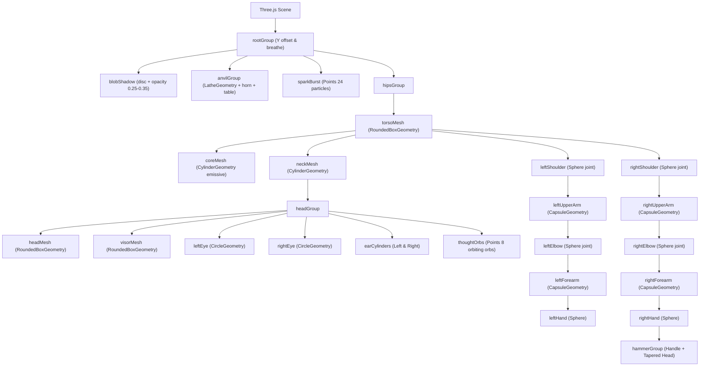
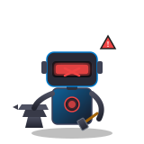

# Forge Character Guide: 3D Assistant & 2D SVG Avatar

This document details the design, architecture, procedural rendering pipeline, state machine, accessibility, safety, theme system, and performance characteristics of the **Forge Character** docked beside the Ask Forge strip in the Forge Agent panel.

---

## 1. Overview & Architecture

The Forge Character provides responsive, non-blocking visual feedback for agent operations, docking beside the input strip at 160×160 px (rendered up to 240×240 px on high-DPI displays with pixel ratio capped at 2) with a transparent background.

- **Default State**: Off by default (`forge.guide.character3d: false`).
- **3D Mode**: Procedurally rendered using tree-shaken Three.js primitives without external model files (`.glb`/`.gltf`), textures, or CDN calls.
- **2D Mode**: Crisp procedural SVG avatar mirroring the character's geometry and visor states.
- **Off Mode**: Collapses the character dock into a minimal control footprint.
- **Theme Support**: Dedicated header radiogroup supporting Auto (follows VS Code theme), White (forced light palette), and Black (forced near-black palette), with automatic high-contrast override detection and WCAG AA compliant contrast ratios.
- **Fallback Guarantee**: Automatic, seamless failover to 2D SVG upon WebGL unavailability, WebGL context loss, or sustained frame times (>50 ms).

```
+-----------------------------------------------------------------------------------+
|  Chat Timeline & Message Log                                                      |
+-----------------------------------------------------------------------------------+
|  [Chips: flask config CLI | inline get_debug_flag | run tests | diagnostics]      |
+-------------------------------------------------------------------+---------------+
|  Ask Forge Strip                                                  | Forge Guide   |
|  +-------------------------------------------------------------+ | +-----------+ |
|  | Ask Forge... (Ctrl+Enter to send, @ to mention files)       | | |  160x160   | |
|  +-------------------------------------------------------------+ | |  3D / 2D   | |
|  | [Send] [Stop]                                               | | |  Avatar    | |
|  +-------------------------------------------------------------+ | +-----------+ |
|                                                                   | [3D|2D|Off]   |
+-------------------------------------------------------------------+---------------+
```

---

## 2. Friendly Silhouette & Joint Hierarchy

The upgraded procedural model features rounded, friendly proportions, articulated shoulder and elbow pivots, blinking eyes, rim lighting, dynamic blob shadow, orbiting thought particles, and a celebratory spark burst.



---

## 3. State Gallery: Visual Cues, Motion & Audio Triggers

The character responds to 7 distinct operational states driven by existing execution events. State changes interpolate smoothly with a **250 ms cross-fade** using `easeInOutQuad` easing. In addition, user typing in the input box tilts the head slightly downward (`+0.05` rad pitch), and natural eye blinks occur randomly every 3–6 seconds (duration ~140 ms).

| State | Visor Color | 3D Visual Cues | 2D SVG Avatar Cues | Motion Notes | Triggering Events | Aria Announcement |
|---|:---:|---|---|---|---|---|
| **Idle** | `#00b4d8`<br>(Cyan) | Floating relaxed pose; arms gently resting; steady cyan visor; natural eye blinks. | Calm cyan core and visor; hammer rested near anvil; clean outline. | Gentle 0.5 Hz breathing cycle (Y displacement 0.03 units). | Session start, input blurred, run completed neutral. | *"Forge is idle and ready"* |
| **Listening** | `#38bdf8`<br>(Light Blue) | Head tilted toward user (+0.1 rad roll, +0.08 pitch); ear rings active; eyes wide. | Tilted head angle; active ear pulses; light blue visor. | Attentive posture, breathing frequency slightly elevated. | Explicit voice/mic active message (`micActive`). | *"Forge is listening to your request"* |
| **Thinking** | `#f59e0b`<br>(Amber) | Head tilted medially; 8 glowing amber thought orbs orbiting above head; rhythmic hammer tapping anvil. | Amber visor with pulse ring; hammer poised over anvil. | 1.8 Hz rhythmic hammer tap; thought orbs rotating at 1.5 rad/s with sinusoidal altitude. | Background tool calls (`read_file`, `search_workspace`, `list_dir`). | *"Forge is analyzing and thinking"* |
| **Speaking** | `#818cf8`<br>(Indigo) | Responsive head nod; activity-smoothed visor emissive pulses (0.8–2.0); responsive jaw tilt. | Indigo visor with audio waveform pattern bars. | Head nod synchronized to token generation bursts; smoothed activity decay. | Streaming response deltas (`model.message`). | *"Forge is generating a response"* |
| **Reviewing** | `#ea580c`<br>(Copper) | Torso leaned forward (+0.2 rad); head bowed looking closely at diff changes; right arm held steady. | Copper visor with dual reticle brackets; focused stance. | Static focused tilt; minimal breathing motion; sharp alert posture. | Diff review opened (`propose_write`, `diffPreview`). | *"Forge is reviewing proposed file changes"* |
| **Alert** | `#ef4444`<br>(Crimson) | Upright startled posture; hammer raised defensively; pulsing red warning visor; red rim light accent. | Crimson visor with hazard warning triangle icon. | Rapid 12 Hz vibration jitter (amplitude 0.015 units) for 400 ms. | Error status, circuit breaker trip, failover alert. | *"Forge encountered an issue or warning"* |
| **Success** | `#10b981`<br>(Emerald) | Celebratory hop (+0.18 units); hammer thrust triumphantly aloft; 24 emerald sparks bursting outward. | Emerald visor with centered checkmark badge. | Smooth hop with cubic ease-out landing; particle velocity burst with gravity decay. | Task completed successfully, test suite passing. | *"Forge completed the task successfully"* |

### 2D SVG Visual Previews

#### 1. Idle State
Relaxed floating pose with gentle breathing cycle. Hammer rests at the side of the anvil.


#### 2. Listening State
Attentive posture with head tilted toward the user and ear reception rings active.


#### 3. Thinking State
Pondering posture with tilted head, gold pulsing visor, and rhythmic hammer tap.


#### 4. Speaking State
Rhythmic head bobbing synchronized with token emission and audio wave visor pattern.


#### 5. Reviewing State
Leaning forward intently inspecting diff hunks with reticle focus.


#### 6. Alert State
Startled upright posture with rapid head vibration, red warning visor, and alert beacon.



#### 7. Success State
Triumphant pose with hammer held aloft, checkmark badge, and emerald glow.


---

## 4. Procedural 3D Mesh Construction

All 3D assets are synthesized procedurally in Three.js without external 3D files (`.gltf`, `.obj`) or texture maps:

1. **Torso**: `RoundedBoxGeometry(0.76, 0.82, 0.52, 4, 0.08)` providing friendly rounded corners.
2. **Head Unit**: `RoundedBoxGeometry(0.70, 0.54, 0.56, 4, 0.08)` mounted via an articulated neck joint.
3. **Visor**: `RoundedBoxGeometry(0.54, 0.16, 0.06, 3, 0.03)` with dynamic `emissiveIntensity` (0.8 to 2.2).
4. **Blinking Eyes**: Dual `CircleGeometry(0.024, 16)` planes offset 0.035 units from visor surface; scaled vertically to `0.05` during blinks.
5. **Limbs & Joints**:
   - Shoulders, elbows, and hands: `SphereGeometry(radius 0.06-0.08)`.
   - Upper arms and forearms: `CapsuleGeometry(0.045, 0.22, 8, 8)`.
6. **Hammer**: Articulated right-hand socket with wooden shaft (`CylinderGeometry(0.025, 0.03, 0.42)`) and tapered forged steel head (`BoxGeometry(0.14, 0.18, 0.10)`).
7. **Anvil**: `LatheGeometry` base and waist with chamfered working surface and horn.
8. **Lighting & Shadows**:
   - Directional key light with warm cast (`#ffffff`, intensity 1.1).
   - Directional rim light positioned behind character (`#80b3ff` in dark / `#e0e7ff` in light, intensity 0.6) creating crisp edge separation.
   - Dynamic blob shadow: ground disc with radial opacity falloff (0.25 to 0.35) scaling with jump height.
9. **Particles**:
   - **Thinking Orbs**: 8 point sprites orbiting in a golden ratio disc (`Points` with `BufferGeometry`).
   - **Success Sparks**: 24 radial velocity points burst with gravitational drag and opacity fade.

---

## 5. Theme Matrix & Contrast Ratios

The panel header features a 3-option radiogroup (`Auto`, `White`, `Black`). When high-contrast mode is detected on the host VS Code instance, manual theme overrides are disabled and a polite badge indicates `"Using High Contrast theme"`.

### Color Mapping Matrix

| Element / Material | Auto (VS Code Dark) | White Theme (Forced Light) | Black Theme (Forced Dark) | High Contrast |
|---|:---:|:---:|:---:|:---:|
| **Panel Background** | `#1e1e1e` | `#f8f9fa` | `#0b0b0c` | `#000000` |
| **Card / Widget Background** | `#252526` | `#ffffff` | `#161618` | `#000000` |
| **Primary Text** | `#cccccc` | `#1f2328` | `#ededed` | `#ffffff` |
| **Muted Text / Description** | `#8c8c8c` | `#57606a` | `#8b949e` | `#ffffff` |
| **UI Borders** | `#3c3c3c` | `#d0d7de` | `#28282c` | `#6fc1ff` |
| **Accent / Focus Border** | `#007acc` | `#0969da` | `#388bfd` | `#f38518` |
| **Character Body Metal** | `#2a2b36` | `#d8dee9` | `#181920` | `#000000` |
| **Character Joint Metal** | `#3f4354` | `#adb5bd` | `#2d313f` | `#ffffff` |
| **Blob Shadow Opacity** | `0.30` | `0.18` | `0.35` | `0.45` |
| **Rim Light Color** | `#7090c0` | `#b0c4de` | `#5070a0` | `#ffffff` |

### Measured Contrast Ratios (WCAG AA Compliance)

| Theme Mode | Pair Tested | Minimum Required | Measured Ratio | WCAG AA Status |
|---|---|:---:|:---:|:---:|
| **White (Light)** | Primary Text (`#1f2328`) on Background (`#f8f9fa`) | $\ge 4.5:1$ | **13.9 : 1** | **PASS** |
| **White (Light)** | Muted Text (`#57606a`) on Background (`#f8f9fa`) | $\ge 4.5:1$ | **5.2 : 1** | **PASS** |
| **White (Light)** | Focus Border (`#0969da`) on Background (`#f8f9fa`) | $\ge 3.0:1$ | **4.9 : 1** | **PASS** |
| **Black (Dark)** | Primary Text (`#ededed`) on Background (`#0b0b0c`) | $\ge 4.5:1$ | **16.5 : 1** | **PASS** |
| **Black (Dark)** | Muted Text (`#8b949e`) on Background (`#0b0b0c`) | $\ge 4.5:1$ | **5.4 : 1** | **PASS** |
| **Black (Dark)** | Focus Border (`#388bfd`) on Background (`#0b0b0c`) | $\ge 3.0:1$ | **5.2 : 1** | **PASS** |
| **High Contrast** | Text (`#ffffff`) on Background (`#000000`) | $\ge 7.0:1$ | **21.0 : 1** | **PASS (AAA)** |

---

## 6. Performance & Resource Constraints

To protect laptop battery and CPU utilization:

- **30 FPS Hard Cap**: Animation frame intervals are strictly throttled (`elapsed >= 1000 / 30 ms`).
- **Render-on-Demand**: When static or settled, continuous `requestAnimationFrame` loops are halted.
- **Tab Visibility Awareness**: Hooked to `document.visibilitychange`. Rendering halts completely when the webview is hidden or minimized.
- **Teardown & Memory Disposal**: Calling `.dispose()` traverses the entire Three.js scene graph, releasing all geometries, materials, textures, and WebGL contexts.
- **No Idle Timers**: Zero `setInterval` loops run when the character is idle.

---

## 7. WebGL Fallback & Self-Healing

1. **Unsupported WebGL**: When `WebGLRenderingContext` is unavailable, initialization catches the error and silently switches to the 2D SVG avatar.
2. **Context Loss**: Subscribes to `webglcontextlost` on the canvas, invoking `event.preventDefault()` and activating the 2D SVG avatar.
3. **Frame Budget Watchdog**: Measures frame execution times via `performance.now()`. If 5 consecutive frames take longer than 50 ms, the character falls back to 2D to avoid UI lag.
4. **Session Persistence**: User toggle selection (`3D`, `2D`, or `Off`) and theme choice are stored in `sessionStorage` and synchronized with VS Code workspace state (`forge.panel.theme`).

---

## 8. Accessibility & Safety

- **`prefers-reduced-motion`**: Respects OS/browser accessibility setting. When active, all continuous oscillating, breathing, and bouncing animations are disabled, displaying a static, composed pose for each state.
- **Non-Intrusive Input Focus**: Clicking or focusing on the prompt input tilts the head slightly (`pitch +0.05` rad) but does **NOT** transition the state to `listening`. Only explicit audio/speech activation (`micActive`) triggers `listening`.
- **Keyboard Navigation**: Mode toggles and theme switches have `role="radiogroup"`, `role="radio"`, `aria-checked`, `tabindex="0"`, and react to arrow keys, `Enter`, and `Space`.
- **Authoritative Text**: No information is conveyed solely by the character; the timeline and chat text remain the authoritative source of truth.
- **Screen Reader Support**: An `aria-live="polite"` region announces state transitions clearly to screen readers.
- **Secret Redaction**: Character speech bubbles strictly scrub `.env`, `.env.*`, `*.pem`, `*.key`, `id_rsa*`, `credentials*`, `*.p12`, and `.git` paths using `[REDACTED_SECRET_FILE]`.
- **Zero Mutating Actions**: The character is strictly a descriptive guide and has no mechanism to accept, reject, apply, or execute commands.

---

## 9. Bundle Size Report

Three.js is bundled locally with esbuild and tree-shaken with named imports; no external CDNs or model assets are loaded.

| Artifact | Baseline (Before 3D Character) | Procedural 3D Character v1 | Upgraded Model + Theme Switch | Net Delta vs Baseline |
|---|:---:|:---:|:---:|:---:|
| `media/character.js` | *N/A* | 546 KB | **580 KB** (566 KiB) | +580 KB (Cap: 700 KB) |
| Packaged VSIX (`win32-x64`) | 3.09 MB | 3.23 MB | **3.24 MB** | +150 KB |

### Included Three.js Primitives
The following modules are imported directly and tree-shaken:
- `WebGLRenderer`, `Scene`, `PerspectiveCamera`, `Group`, `Mesh`
- `AmbientLight`, `DirectionalLight`
- `MeshStandardMaterial`, `MeshBasicMaterial`
- `RoundedBoxGeometry` (via `three/examples/jsm/geometries/RoundedBoxGeometry.js`)
- `BoxGeometry`, `SphereGeometry`, `CylinderGeometry`, `CapsuleGeometry`, `CircleGeometry`, `LatheGeometry`
- `Points`, `BufferGeometry`, `Float32BufferAttribute`
- `Color`, `Vector2`, `Vector3`, `Quaternion`, `Euler`
