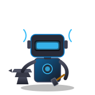
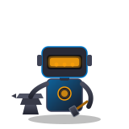
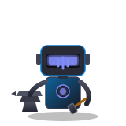

# Forge Character Guide: 3D Assistant & 2D SVG Avatar

This document details the design, architecture, rendering pipeline, state machine, accessibility, safety, and performance characteristics of the **Forge Character** docked beside the Ask Forge strip in the Forge Agent panel.

---

## 1. Overview & Architecture

The Forge Character provides responsive, non-blocking visual feedback for agent operations, docking beside the input strip at 160×160 px with a transparent background.

- **Default State**: Off by default (`forge.guide.character3d: false`).
- **3D Mode**: Procedurally rendered using tree-shaken Three.js primitives without external model files, textures, or CDN calls.
- **2D Mode**: Crisp procedural SVG avatar mirroring the character's geometry and visor states.
- **Off Mode**: Collapses the character dock into a minimal control footprint.
- **Fallback Guarantee**: Automatic, seamless failover to 2D SVG upon WebGL unavailability, WebGL context loss, or sustained frame times (>50 ms).

```
+-----------------------------------------------------------------------------------+
|  Chat Timeline & Message Log                                                      |
+-----------------------------------------------------------------------------------+
|  [Chips: flask config CLI | inline get_debug_flag | run tests | diagnostics]      |
+-------------------------------------------------------------------+---------------+
|  Ask Forge Strip                                                  | Forge Guide   |
|  +-------------------------------------------------------------+ | +-----------+ |
|  | Ask Forge... (Ctrl+Enter to send, @ to mention files)       | | |  160x160   | |
|  +-------------------------------------------------------------+ | |  3D / 2D   | |
|  | [Send] [Stop]                                               | | |  Avatar    | |
|  +-------------------------------------------------------------+ | +-----------+ |
|                                                                   | [3D|2D|Off]   |
+-------------------------------------------------------------------+---------------+
```

---

## 2. States & Visual Representations

The character responds to 7 distinct operational states driven by existing execution events. Each state adjusts the character's pose, glowing visor emissive color, and accessibility announcements.

| State | Visor Color | Triggering Events | Aria Announcement |
|---|:---:|---|---|
| **Idle** | `#00b4d8` (Cyan) | Run completed, input blurred, neutral baseline | *"Forge is idle and ready"* |
| **Listening** | `#38bdf8` (Light Blue) | User focus on Ask Forge input, mic/speech input | *"Forge is listening to your request"* |
| **Thinking** | `#f59e0b` (Amber) | Tool calls (`read_file`, `search_workspace`, etc.) | *"Forge is analyzing and thinking"* |
| **Speaking** | `#818cf8` (Indigo) | Streaming response deltas (`model.message`) | *"Forge is generating a response"* |
| **Reviewing** | `#ea580c` (Copper) | Proposal creation (`propose_write`, `diffPreview`) | *"Forge is reviewing proposed file changes"* |
| **Alert** | `#ef4444` (Crimson) | Error status, circuit breaker trip, failover notices | *"Forge encountered an issue or warning"* |
| **Success** | `#10b981` (Emerald) | Run completed with status ok, tests passing | *"Forge completed the task successfully"* |

---

### Visual Previews by State

#### 1. Idle State
Relaxed floating pose with gentle breathing cycle. Hammer rests at the side of the anvil.


#### 2. Listening State
Attentive posture with head tilted toward the user and ear reception rings active.



#### 3. Thinking State
Pondering posture with tilted head, gold pulsing visor, and rhythmic hammer tap.



#### 4. Speaking State
Rhythmic head bobbing synchronized with token emission and audio wave visor pattern.



#### 5. Reviewing State
Leaning forward intently inspecting diff hunks with reticle focus.


#### 6. Alert State
Startled upright posture with rapid head vibration, red warning visor, and alert beacon.


#### 7. Success State
Triumphant pose with hammer held aloft, checkmark badge, and emerald glow.


---

## 3. Procedural 3D Mesh Construction

All 3D assets are synthesized procedurally in Three.js without external 3D files (`.gltf`, `.obj`) or texture maps:

1. **Torso**: `BoxGeometry(0.8, 0.85, 0.55)` with chamfered low-poly bevel.
2. **Reactor Core**: `CylinderGeometry(0.12, 0.12, 0.08, 12)` with state-reactive emissive glow.
3. **Head Unit**: `BoxGeometry(0.72, 0.56, 0.6)` with antenna exhaust cylinders on sides.
4. **Visor**: `BoxGeometry(0.56, 0.18, 0.08)` utilizing `MeshStandardMaterial` with `emissiveIntensity: 1.0–1.8`.
5. **Right Arm & Hammer**: Articulated shoulder joint, wooden handle (`CylinderGeometry`), and forged steel head (`BoxGeometry`).
6. **Anvil**: Multi-stage forged anvil comprising base, waist, horn, and working table.
7. **Theme Integration**: Materials sample `--vscode-sideBar-background`, `--vscode-button-background`, and `--vscode-focusBorder` dynamically.

---

## 4. Performance & Resource Constraints

To protect laptop battery and CPU utilization:

- **30 FPS Hard Cap**: Animation frame intervals are strictly throttled (`elapsed >= 1000 / 30 ms`).
- **Render-on-Demand**: When static or settled, continuous `requestAnimationFrame` loops are halted.
- **Tab Visibility Awareness**: Hooked to `document.visibilitychange`. Rendering halts completely when the webview is hidden or minimized.
- **Teardown & Memory Disposal**: Calling `.dispose()` traverses the entire Three.js scene graph, releasing all geometries, materials, and renderer contexts.
- **No Idle Timers**: Zero `setInterval` loops run in the background.

---

## 5. WebGL Fallback & Self-Healing

1. **Unsupported WebGL**: When `WebGLRenderingContext` is unavailable, initialization catches the error and silently switches to the 2D SVG avatar.
2. **Context Loss**: Subscribes to `webglcontextlost` on the canvas, invoking `event.preventDefault()` and activating the 2D SVG avatar.
3. **Frame Budget Watchdog**: Measures frame execution times via `performance.now()`. If 5 consecutive frames take longer than 50 ms, the character falls back to 2D to avoid UI lag.
4. **Session Persistence**: User toggle selection (`3D`, `2D`, or `Off`) is stored in `sessionStorage` and remembered for the session.

---

## 6. Accessibility & Safety

- **`prefers-reduced-motion`**: Respects the OS/browser accessibility setting. When active, all continuous oscillating and bouncing animations are disabled, displaying a static, composed pose for each state.
- **Keyboard Navigation**: Mode toggle buttons have `tabindex="0"`, `role="radio"`, and react to `Enter` and `Space`.
- **Authoritative Text**: No information is conveyed solely by the character; the timeline and chat text remain the authoritative source of truth.
- **Screen Reader Support**: An `aria-live="polite"` region announces state transitions clearly to screen readers.
- **Secret Redaction**: Character speech bubbles strictly scrub `.env`, `.env.*`, `*.pem`, `*.key`, `id_rsa*`, `credentials*`, `*.p12`, and `.git` paths using `[REDACTED_SECRET_FILE]`.
- **Zero Mutating Actions**: The character is strictly a descriptive guide and has no mechanism to accept, reject, apply, or execute commands.

---

## 7. Package Size Impact

- **Three.js Tree-Shaking**: Imports only 15 core Three.js primitives (geometries, materials, scene, camera, lights).
- **Bundle File**: `media/character.js` (546 KB minified JavaScript).
- **Compressed VSIX Increase**: The packaged Windows VSIX increases by only **~142 KB** (from 3.09 MB to 3.23 MB).
