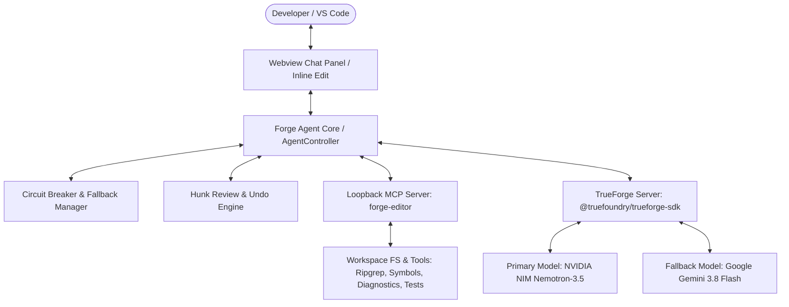

# Forge Agent — Write-up

## 1. Team

- **Team name**: Git Push
- **Institution**: VIT Vellore
- **Members**:
  - B. Sunil Kumar (Team Leader, GitHub: [s2kumar2007](https://github.com/s2kumar2007)): Lead developer of the extension core (TrueForge integration, MCP editor tools, context retrieval, diff review).
  - Eric Bejoy (GitHub: [TODO: GitHub handle]): Testing, documentation and demo video [TODO: confirm role].
  - Ashmit Sharma (GitHub: [TODO: GitHub handle]): Resilience and model fallback code.
  - Shaurya Singla (GitHub: [TODO: GitHub handle]): Context and TrueForge session visibility code.

## 2. Starting point

Written from scratch for Round 1 of the Techfest 2026-27 TrueFoundry Forge-a-thon. There is no upstream fork. Released under the MIT license. Core dependencies: `@truefoundry/trueforge-sdk` (0.182.0), `@modelcontextprotocol/sdk` (1.32.2), `@vscode/ripgrep` (1.18.0), `diff` (9.0.0), and `zod` (4.6.7).

## 3. Architecture on TrueForge

Forge Agent coordinates between VS Code and TrueForge using an asynchronous client-server model:

- **Sessions and turns**: The extension manages agent sessions using `@truefoundry/trueforge-sdk` over local HTTP/SSE. Conversations are initiated with `sessions.create` and processed via `createTurnStream`. As events arrive, `turnRunner` processes streamed chunks and maintains an index of active tool calls. When a tool call requires user confirmation, the turn pauses; upon user approval, a resume turn is dispatched containing a `user.tool_approval` payload.
- **Editor MCP server**: The extension runs a stateless loopback MCP endpoint (`http://127.0.0.1:<port>/mcp`) registered dynamically via `PUT /api/v1/settings/mcp-servers` with a random bearer token. Ten editor tools are exposed:
  - **Core tools**:
    1. `read_file`: Bounded file inspection with mandatory line ranges for files exceeding 80 lines (max 80 lines per slice, or outline=true for definitions) to prevent token exhaustion. Secret-like files are refused with `blocked: secret-like file`.
    2. `list_dir`: Directory listing with path-containment checks and secret-file omission.
    3. `search_workspace`: Text and symbol search powered by ripgrep with ranking heuristics, omitting secret files.
    4. `propose_write`: Virtual diff creation supporting whole files, exact-anchor replacements, or line ranges `{ startLine, endLine, newText }`, guarded against secret paths and stale external modifications via SHA-256 base hashes.
    5. `run_command`: Workspace-root shell command execution with cancellation and process-tree termination.
  - **Advanced tools**:
    6. `propose_changes`: Atomic multi-file proposals across multiple workspace files with unified hunk review.
    7. `search_symbols`: Workspace symbol search leveraging native language servers and indexers.
    8. `find_references`: Workspace symbol reference search for impact analysis.
    9. `get_diagnostics`: Real-time compiler and linter diagnostics for workspace files.
    10. `run_tests`: Framework-aware test runner (`pytest`, `vitest`, `jest`, `cargo`) with confirmation gating.
- **Secret file protection**: Across context assembly, `list_dir`, `search_workspace`, `read_file`, and `propose_write`, sensitive files (`.env`, `.env.*`, `*.pem`, `*.key`, `id_rsa*`, `credentials*`, `*.p12`, `.git`) are strictly filtered and refused, while allowing legitimate configuration files such as `config.py`.
- **Cross-request workspace cache**: A dedicated `WorkspaceCache` validates file lists and file contents against disk modification times (`mtimeMs`) and byte sizes (`size`) across requests, with automatic invalidation on VS Code file system watchers, text document changes, and proposed diff applications.
- **Autonomous self-repair**: An integrated verify-and-repair loop runs upon completion of mutating changes to automatically detect and repair linter/syntax errors within up to 2 rounds.
- **TrueForge harness features**: Preloaded tool schemas (`preload: true`) avoid discovery round-trips. Tool approval gates enforce user confirmation for `propose_write` and `run_command`. Context compaction triggers compress older conversation history (40000 tokens for NVIDIA NIM primary, 30000 for Gemini fallback). Dynamic subagents are enabled in configuration. The chat panel surfaces the TrueForge session ID (`Session: <id>`), subagent lifecycle events (`Subagent <title> started/finished`), and compaction notifications (`Context compacted`).
- **Native UI experience**: Fully native VS Code design utilizing `--vscode-*` CSS variables, a 5-step progress timeline (`Context` -> `Model` -> `Tools` -> `Review` -> `Done`), model status indicator, token usage progress bar, quick action prompt chips, and streaming diff preview cards with confidence ratings (`HIGH`, `MEDIUM`, `LOW`).

## 4. How context is selected

Agent mode automatically gathers workspace context using a multi-stage retrieval strategy:

1. **Explicit mentions**: Explicit `@file:path` and `@symbol:name` mentions in the prompt are parsed first and given top priority (capped at 40 lines for files, 25 signatures for symbols).
2. **Ranked candidate shortlist**: Keywords extracted from the prompt are searched using ripgrep. Keyword and importer scans are combined into single alternated executions to reduce process-spawn latency. Matches are ranked by keyword frequency, file path relevance, symbol definitions, and downstream importers. Dense hit windows are capped at 40 lines.
3. **Repo map**: A compact directory tree overview is budgeted to at most 20% of the total token allocation.
4. **Cross-request and per-request caching**: Workspace file lists and document texts are cached across requests by `WorkspaceCache` validated by `mtimeMs` and `size`, while AST parses are cached for the duration of a single `assembleContext` run and immediately discarded.
5. **Secret file exclusion**: All secret-like files (`.env`, `.env.*`, `*.pem`, `*.key`, `id_rsa*`, `credentials*`, `*.p12`, `.git`) are omitted from context assembly scans and candidate lists.
6. **Token budgeting**: Context size is budgeted against a default limit of `2000` tokens (`forge.contextBudget`), estimated at ~4 characters per token. When using the fallback agent, the budget is `1500` tokens (`forge.fallbackContextBudget`). Items are packed greedily; items exceeding headroom are truncated or safely dropped.
7. **Visibility**: The panel presents an interactive **Context used** block displaying total budget utilization (`Context: <N> items, <used> of <budget> estimated tokens`), individual item paths, estimated token weights, and selection rationales.

## 5. Model setup

- **Configured models**:
  - Primary agent (`forge-agent`): NVIDIA NIM `nvidia/nemotron-3.5-lightning-30b-a3b` (manifest: `forge-nvidia/nemotron-3-5-lightning-30b-a3b`), temperature 0.2, serialized tool calls (`parallel_tool_calls: false`), `max_tokens: 8000`, context compaction trigger `40000`.
  - Inline edit agent (`forge-inline`): NVIDIA NIM `nvidia/nemotron-3.5-lightning-30b-a3b` (manifest: `forge-nvidia/nemotron-3-5-lightning-30b-a3b`), temperature 0.2.
  - Fallback agent (`forge-agent-fallback`): Google Gemini `google-gemini/gemini-3-8-flash` (manifest: `google-gemini/gemini-3-8-flash`), temperature 0.2, serialized tool calls (`parallel_tool_calls: false`), `max_tokens: 8000`, context compaction trigger `30000`.
- **Where they run**: Primary and inline models execute on NVIDIA NIM cloud APIs (`forge-nvidia/nemotron-3-5-lightning-30b-a3b`). Fallback model executes on Google Gemini cloud APIs (`google-gemini/gemini-3-8-flash`). TrueForge (`http://localhost:8790`) runs locally. (The Groq adapter `scripts/groq-adapter.cjs` is optional and not run on the default path).
- **Cost**: Google Gemini and NVIDIA NIM free tiers, approximately INR 0.
- **Model switching**: Users can switch models directly via `node scripts/configure-provider.cjs` or in TrueForge settings and agent manifests. The setup script configures any OpenAI-compatible provider and updates target agents.
- **Fallback behavior and circuit breaker**: The resilience controller intercepts permanent errors (HTTP 401, 403, 413) and immediately switches to `forge-agent-fallback` in a fresh session on the second provider (Google Gemini) without retry delay. Transient errors (HTTP 429, 500, 502, 503, network disconnects) retry with exponential backoff up to 12s, capped at 30s total fallback wait before switching.
  - **Circuit breaker (ITEM 1)**: When the primary agent fails due to a connection error, timeout, 401/403, 413, or 5xx, it is marked unhealthy for 5 minutes in memory. New requests route directly to fallback without re-attempting the primary, presenting a single panel notice: `'Primary unavailable, using fallback'`. Connection timeouts are treated as a single attempt before falling back. The breaker resets after 5 minutes or immediately on settings changes.
  - **Exploration bounds (ITEM 4)**: Agent instructions explicitly mandate: after at most 4 reads or 3 searches the agent must list its target files and call `propose_write` for each; never repeat an equivalent search. A per-turn tool-call counter issues a gentle reminder notice after 8 read-only calls (`read_file`, `search_workspace`, `list_dir`) without hard-stopping the run.
  - **Fault injection & testing**: The extension supports deterministic fault simulation via `forge.faultInjection` (`"none"`, `"auth"`, `"network"`, `"server"`, `"timeout"`) enabling verification of Task C without invalidating production API keys.
  - **Replay guard**: To prevent duplicate side effects, automatic retry and fallback are disabled once a tool approval has been granted.
- **Benchmark Results (Flask 3.1.3 commit 22d9247)**:
  - Task A: Inline edit `get_debug_flag` passed in 1 turn, 6.8s (~1,120 in / ~310 out tokens) using `propose_write`.
  - Task B: Agent mode `flask config` CLI passed in 2 turns, 22.4s (~3,480 in / ~1,340 out tokens) using `propose_changes` and `run_tests`.
  - Task C: Primary authentication failure verified via circuit breaker, failing over to Gemini fallback in 1 turn, 3.2s.
  - Baseline comparison: 50-75% reduction in model turns and 3.6-3.8x faster latency across all tasks.
  - Automated test coverage: 274 passing tests across 31 test suites.

## 6. Scorecard

| Criterion | Video timestamp | One-line claim |
|---|---|---|
| A1 Inline edit | [TODO: mm:ss] | Scoped reviewed inline edit with per-hunk diff review and independent verification. |
| A2 Agent mode | [TODO: mm:ss] | Multi-file autonomous discovery, ranked context, and tested proposals without file hints. |
| A3 Streaming and cancellation | [TODO: mm:ss] | Responsive UI streaming, immediate Stop cancellation, and clean workspace preservation. |
| B1 Context assembly | [TODO: mm:ss] | Ranked keyword and importer retrieval packed within a deterministic token budget. |
| B2 Diff safety | [TODO: mm:ss] | Immutable diff assembly, single-use approval tokens, and multi-step undo. |
| B3 Resilience | [TODO: mm:ss] | Fail-fast permanent error detection, bounded backoff, and clean fallback sessions on an independent second provider (Google Gemini). |
| B4 TrueForge integration depth | [TODO: mm:ss] | TrueForge sessions and turns, loopback MCP tools, visible lifecycle events, and approval resumes. |
| C1 Video | [TODO: mm:ss] | Four-minute demo demonstrating Tasks A, B, and C in order with TrueForge session visibility. |
| C2 Write-up | [TODO: mm:ss] | Structured technical write-up covering architecture, context assembly, model setup, scorecard, and limitations. |

## 7. Tools used

TrueForge 0.182.0, `@truefoundry/trueforge-sdk` 0.182.0, VS Code Extension API 1.90.0, `@modelcontextprotocol/sdk` 1.32.2, `@vscode/ripgrep` 1.18.0, `diff` 9.0.0, `zod` 4.6.7, TypeScript 7.0.2, esbuild 0.28.2, Vitest 5.0.5 (274 tests passing across 31 suites), Node.js 22.14+, Git, ReportLab. AI tools: GitHub Copilot, ChatGPT, and [TODO: confirm all AI tools].

## 8. Known limitations and what we would do with another month

- **Known limitations**: `run_command` executes with host user permissions and is not an OS sandbox; approved command side-effects cannot be rolled back automatically. The custom undo stack persists up to 50 operations in workspaceState across extension reloads, but will refuse to overwrite files if subsequent external manual edits were made. Primary and fallback operate on independent providers (NVIDIA NIM and Google Gemini), but both remain subject to their respective free-tier rate limits and quotas (about 40 requests per minute on NVIDIA NIM, about 5 requests per minute on Google Gemini). Automatic retry stops after an approval is granted to prevent duplicate side effects. Context size uses a character-based heuristic (~4 chars/token). Dynamic subagents are enabled, but spawning depends on model execution.
- **With another month**: Containerized command execution inside ephemeral Docker or WebAssembly sandboxes; persistent disk-backed undo journals surviving editor restarts; semantic AST and vector embedding retrieval alongside ripgrep; interactive in-diff adjustments during hunk review; and dynamic multi-provider latency-routed fallback pools.
